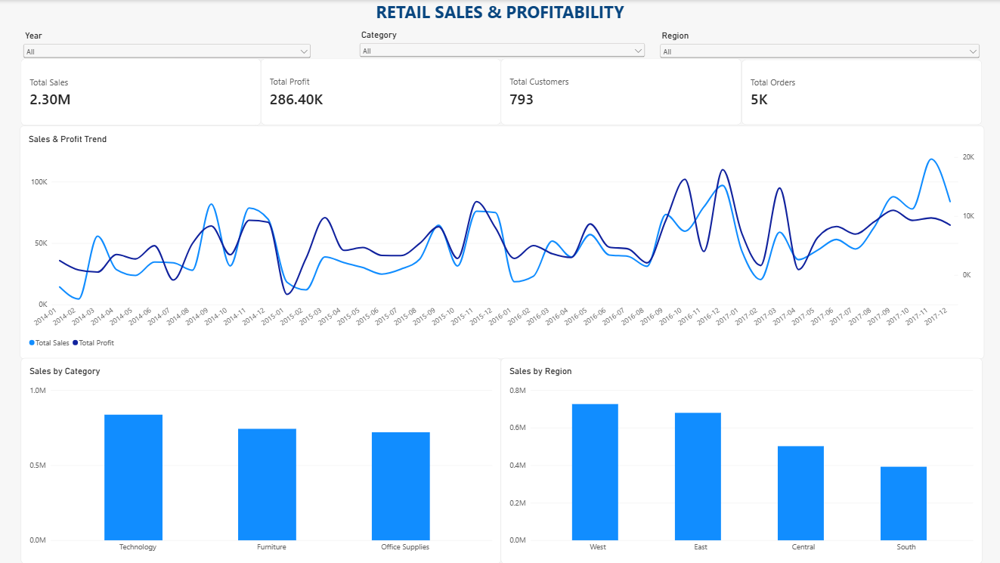
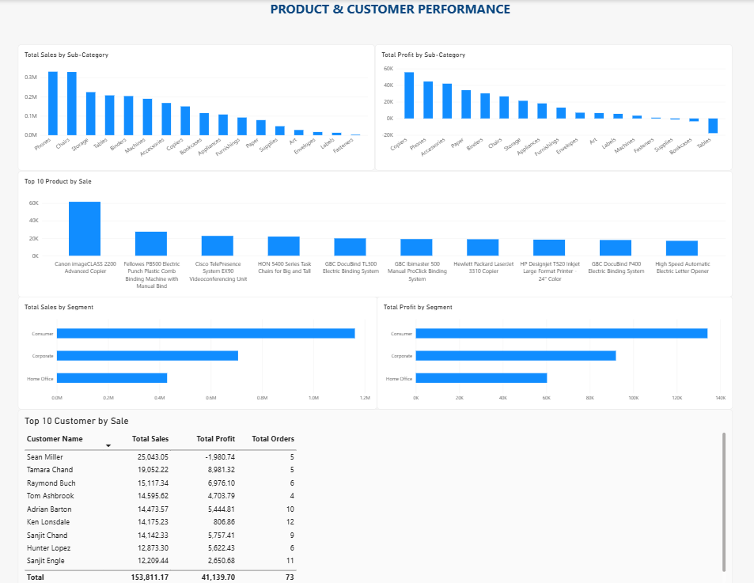
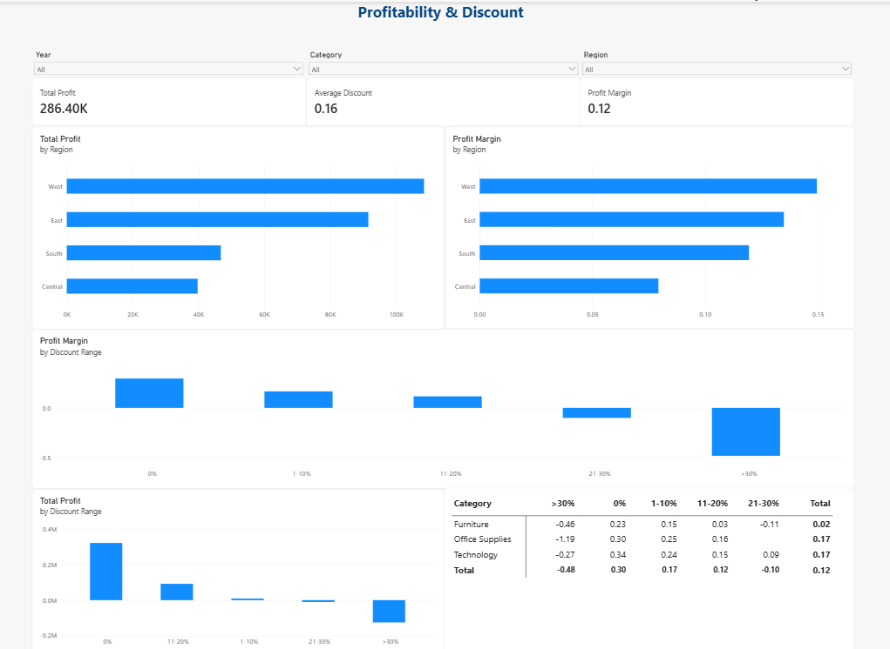

# Retail Sales & Profitability Analysis

## Project Overview

This project analyzes retail sales and profitability performance from 2014 to 2017 to help identify sales trends, product performance, customer contributions, regional performance, and the relationship between discount levels and profitability.

The goal is to turn transactional data into actionable business insights using SQL and Power BI.

## Business Questions

The analysis focuses on five key business questions:

1. **Sales Trends:** How did sales and profit change over time?
2. **Product Performance:** Which categories, sub-categories, and products contributed the most to sales and profit?
3. **Customer & Segment Performance:** Which customers and customer segments contributed the most to business performance?
4. **Regional Performance:** How did sales and profitability vary across regions?
5. **Discount & Profitability:** How were discount levels associated with profit and profit margin?

## Dataset

- **Dataset:** Sample Superstore
- **Period:** 2014–2017
- **Source:** [Superstore Dataset on Kaggle](https://www.kaggle.com/datasets/vivek468/superstore-dataset-final)
- **Data type:** Retail order-level / order-line transactional data

The dataset contains sales transactions with information about orders, customers, products, categories, regions, discounts, and profit.

*Note: Please refer to the original dataset source for its terms of use and redistribution conditions.*

## Tools & Technologies

- **PostgreSQL:** Data validation, aggregation, joins, and business analysis
- **Power Query:** Data cleaning and transformation
- **Power BI:** Data modeling, DAX measures, and interactive dashboards
- **DAX:** KPI calculations and profitability metrics

## Project Workflow

1. **Business Understanding** — Defined the business problem and analytical questions.
2. **Data Exploration & Cleaning** — Inspected data quality, standardized fields, checked data types, and validated key values.
3. **SQL Analysis** — Analyzed sales trends, product performance, customer contributions, regional performance, and profitability.
4. **Data Modeling** — Organized the data for analysis in Power BI using a fact-and-dimension model.
5. **Dashboard Development** — Created interactive report pages with KPI cards, trend charts, comparisons, and discount analysis.
6. **Business Insights** — Interpreted the findings and developed potential recommendations based on the results.

## SQL Analysis

The SQL scripts are organized by analytical purpose:

| File | Purpose |
|---|---|
| `01_data_quality.sql` | Validate missing values, duplicates, data types, and important business rules |
| `02_sales_analysis.sql` | Analyze overall performance, time trends, segments, and regions |
| `03_product_analysis.sql` | Compare category, sub-category, and product performance |
| `04_customer_analysis.sql` | Identify top customers by sales and profit |
| `05_profitability_analysis.sql` | Analyze profit margins and discount levels |

## Power BI Dashboard

### 1. Executive Overview

Provides a high-level view of sales, profit, orders, customers, monthly performance trends, and sales by category and region.



### 2. Product & Customer Performance

Examines sales and profit by sub-category, top-performing products, customer segments, and key customers.



### 3. Profitability & Discount

Examines regional profitability, profit margins, and how profitability varies across discount ranges and product categories.



## Key Business Insights

*This section will be completed after validating the results from SQL and Power BI.*

For each insight, document:

- **Observation:** What pattern was identified?
- **Evidence:** Which metric, comparison, or chart supports the finding?
- **Business implication:** Why does the finding matter?
- **Potential action:** What could the business investigate or consider doing next?

See [`insights/business_insights.md`](insights/business_insights.md) for the detailed findings.

## Limitations

- The analysis is based on the available historical dataset and may not represent current business conditions.
- The observed relationship between discounts and profitability does not, by itself, establish causation.
- Recommendations should be evaluated alongside additional business context before implementation.

## Repository Structure

```text
data/        Raw and cleaned datasets
sql/         PostgreSQL validation and analysis queries
powerbi/     Power BI report
screenshots/ Dashboard screenshots
insights/    Business findings and recommendations
README.md    Project documentation
```

## How to Explore This Project

1. Review the dashboard screenshots above.
2. Explore the SQL scripts to understand the analysis.
3. Open `powerbi/retail_sales_analysis.pbix` in Power BI Desktop to interact with the report.
4. Read `insights/business_insights.md` for the findings and recommendations.
